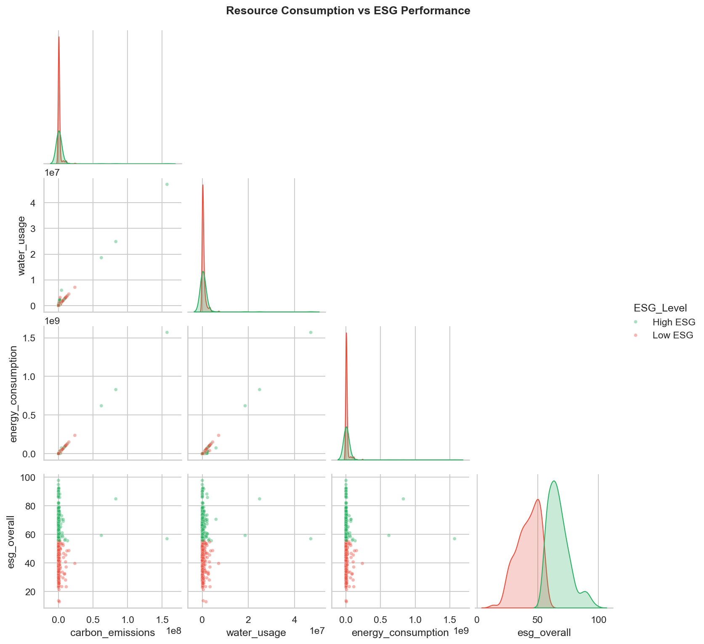

# esg-fin-eda

Reproducible Exploratory Data Analysis on synthetic ESG & Financial Performance data (2000 firms × 9 industries × 2015–2025).

Demonstrates end-to-end analytical workflow: **data generation → cleaning → visualization → insight extraction**.

## Project Structure
esg-fin-eda/  
├── data/  
│   └── company_esg_financial_dataset.csv 
├── notebooks/  
│   └── esg-fin-eda.ipynb          # main analysis  
├── figs/                          # output visualizations  
│   ├── industry_esg.png  
│   ├── esg_profit.png  
│   ├── region_carbon.png  
│   ├── corr.png  
│   └── resource_esg.png  
└── README.md  

## Key Findings
1、Industry divergence: Finance tops all three ESG pillars; Transport/Energy posts the lowest Environmental scores (synthetic sample, n=1,000, 9 industries)  
2、ESG-profit link: Weak positive correlation (r≈{:.2f}, p<0.01) with pronounced cross-industry heterogeneity  
3、Disclosure-emission decoupling: High-disclosure regions do not map to low emissions — consistent with independent variable generation in synthetic data  
4、Correlation architecture: E/S/G pillars tightly coupled (r>0.7); carbon metrics near-orthogonal to financial indicators  

## Visualizations
| Chart | Preview |
|-------|---------|
| Industry ESG scores |  |
| ESG–Profit relation |  |
| Disclosure vs Emission |  |
| Correlation matrix |  |
| Resource–ESG |  |

## Tech Stack
`Python 3.10+` · `pandas` · `seaborn` · `matplotlib` · `scipy` · `Jupyter`

## Data Disclaimer
The company_esg_financial_dataset.csv is a synthetic dataset​ published on Kaggle (Shriyash Jagtap, CC BY 4.0). It simulates 1,000 firms × 9 industries × 2015–2025. All findings are illustrative of the analytical pipeline, not empirical ESG facts.

## Author
**sight-link** — Financial Data Analytics | FinTech × ESG Research

*Part of a dual-repo portfolio: [`esg-fintext-demo`](https://github.com/sight-link/esg-fintext-demo) (NLP text classification) + `esg-fin-eda` (tabular EDA)*
