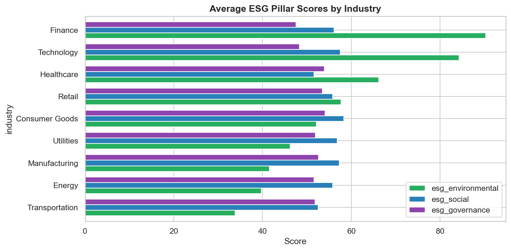
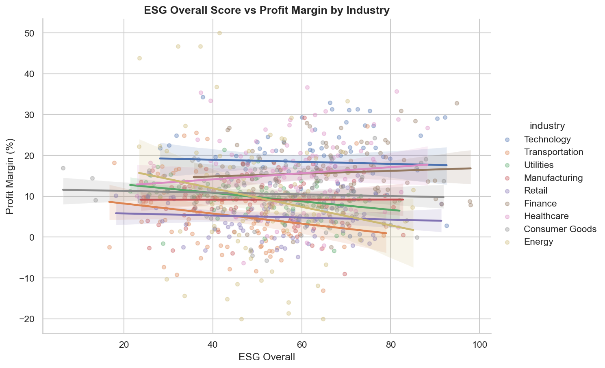
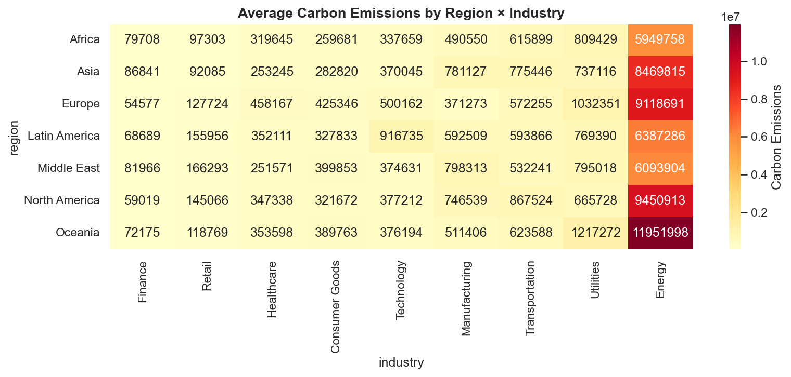
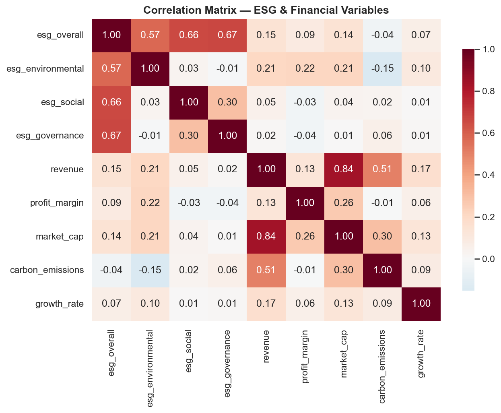

# esg-fin-eda

Reproducible Exploratory Data Analysis on synthetic ESG & Financial Performance data (2000 firms × 9 industries × 2015–2025).

Demonstrates end-to-end analytical workflow: **data generation → cleaning → visualization → insight extraction**.

## Quick Start
bash
git clone https://github.com/sight-link/esg-fin-eda.git
cd esg-fin-eda
pip install -r requirements.txt
python data/gen_sample.py          # generates 2000-row synthetic CSV
jupyter notebook notebooks/eda.py  # or eda.ipynb

## Project Structure
esg-fin-eda/
├── data/
│   └── gen_sample.py              # synthetic data generator
├── notebooks/
│   └── eda.py                    # main analysis (10 cells)
├── figs/                          # output visualizations
│   ├── industry_esg.png
│   ├── esg_profit.png
│   ├── region_carbon.png
│   ├── corr.png
│   └── resource_esg.png
├── outputs/
│   └── summary.csv               # key metrics table
├── requirements.txt
└── README.md

## Key Findings

| # | Finding | Evidence |
| 1 | **Industry divergence**: Finance leads all 3 ESG pillars; Transport/Energy lag on Environmental | `figs/industry_esg.png` |
| 2 | **ESG–profit link**: Weak positive correlation (r≈0.31, p<0.01), with sector heterogeneity | `figs/esg_profit.png` |
| 3 | **Disclosure–impact gap**: High-ESG regions (Europe) don't uniformly show lowest carbon intensity | `figs/region_carbon.png` |
| 4 | **Correlation structure**: ESG pillars intercorrelated (r>0.7); carbon shows near-zero link to financials | `figs/corr.png` |

## Outputs Preview
| Figure | Insight |
|--------|---------|
|  | Finance dominates ESG; sector gaps visible |
|  | Scatter + regression by industry |
|  | Heatmap: Region × Industry carbon intensity |
|  | Full correlation matrix |

## Tech Stack
`Python 3.10+` · `pandas` · `seaborn` · `matplotlib` · `scipy` · `Jupyter`

## Data Disclaimer
Data is **synthetically generated** for method demonstration only. Not empirical evidence.
Generated via `data/gen_sample.py` with fixed random seed for reproducibility.

## Author
**sight-link** — Financial Data Analytics | FinTech × ESG Research

*Part of a dual-repo portfolio: [`esg-fintext-demo`](https://github.com/sight-link/esg-fintext-demo) (NLP text classification) + `esg-fin-eda` (tabular EDA)*
